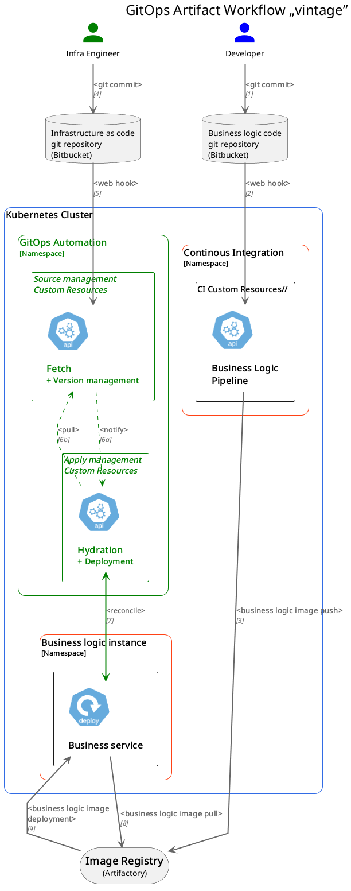
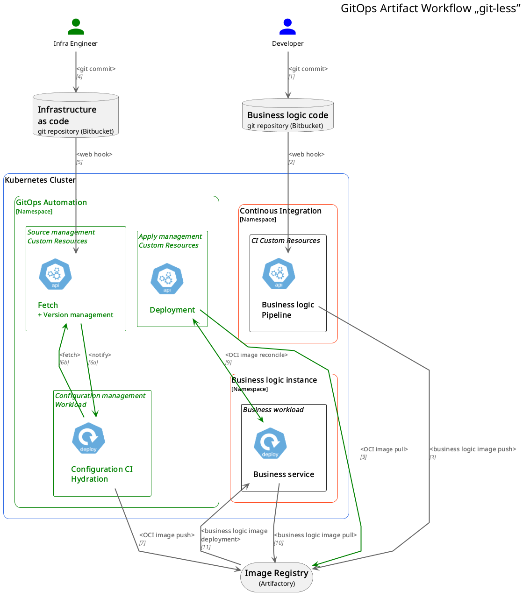
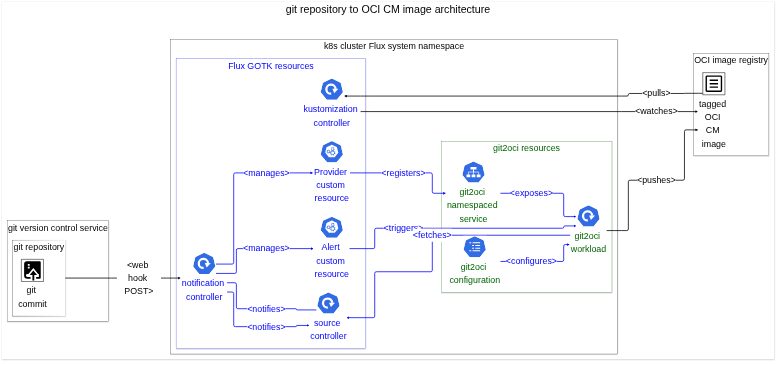

### What?
Switch from controller-integrated hydration to provisioning configuration from OCI images

<table>
<tr>
<th align="center">From:</th>
<th align="center">To:</th>
</tr>
<tr>
<td style="border-right: 2px solid black;">

</td>
<td>

</td>
</tr>
</table>

### Why?
Advantages of OCI image based configuration:
* reduced dependency set: for performing disaster recovery and operating static configurations,
  git services are no longer required
* for operating workloads, the image registry (where the business logic image live anyway) is enough
  – the git service is only needed to roll out configuration changes (analogous to business logic development)
* configuration OCI images can be made immutable, as they can be delivered completely parametrized
* image versioning mechanics (i.e. semantic version tagging) can also be transferred from business logic images
* hydration tooling is no longer limited to Helm and kustomize

### Fundamental design principles for a dedicated „nano-CI” for OCI configuration image build+push

#### Purpose
If a CM git repository changes content (=new commits) or meta-information (=new
[semantic versioning](https://semver.org/)
tags)
* the repository's content shall be hydrated
* and a new OCI image containing the hydrated k8s resources shall be tagged appropriately, and pushed into an image registry

#### Why not use Tekton for building configuration OCI images?
* GitOps automation should have no additional dependencies besides k8s and the automation toolkit used
* Tekton installation may be managed via GitOps as target itself, so using Tekton for configuration OCI
  image builds would introduce a circular dependency
* configuration hydration is **much** simpler than business logic image build, Tekton would be overkill
* **but**: configuration hydration is **much more** critical than business logic image building:  
  if it isn't available, configuration changes cannot be applied via the GitOps control loop!
  
#### Integration / execution environment
The nano CI service shall
* be embedded into the GitOps automation, i.e. it shall not expose a service outside the k8s cluster
* use the GitOps automation it is embedded in for source version and notification management
* if possible (i.e. if not prevented by security constraints like CVE vulnerabilities), use unmodified upstream images
* be maximally flexible when hydrating:  
  details on how to hydrate the content of CM git repositories (tooling, configuration etc.) shall be extracted from
  those repositories
* implement sandboxing for hydration, i.e. run each hydration task in a separate environment that is separated from the
  rest of the CI service and other hydration tasks

#### Configuration management nano CI architecture

